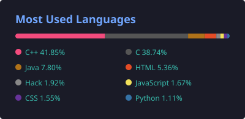
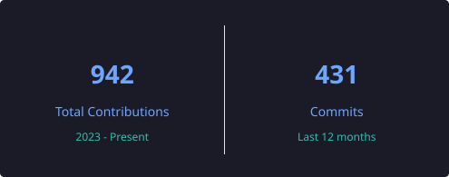

  

## 🙋‍♂️ About me

I'm a developer from Brazil who loves to build cool things — from code that makes robots move to full-stack web and mobile applications. I enjoy working across the whole stack, from hardware and C++ up to TypeScript front-ends.

## 💻 My programming languages

  

## 📊 GitHub stats

  
  

## 🧰 I've already used:

  

## 🤝 Connect with me

  
  

